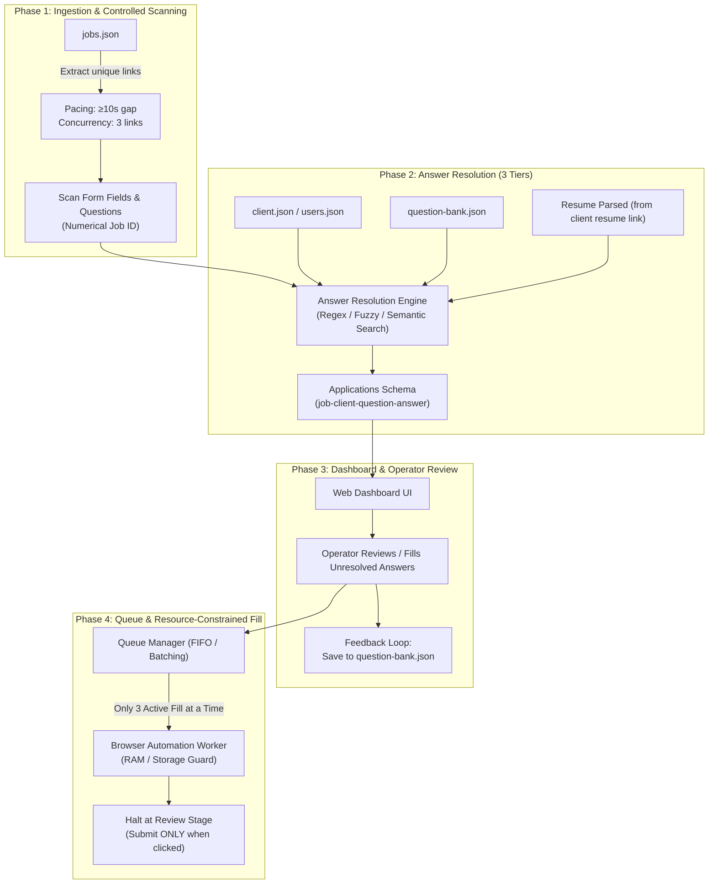

# System Architecture & Scaling Specification (`scaling.md`)

This document specifies the current local testing architecture, operational workflows, and future cloud scaling roadmap based on system designs and notebook specifications.

---

## 1. High-Level Pipeline Overview



---

## 2. Ingestion & Scanning Specifications

### Input Source
- **Primary Source**: `data/jobs.json` (ingested from CSV or API).
- **Target Extraction**: Extract canonical, deduplicated URLs removing third-party tracking tokens (`utm_*`, `source`, `ref`).
- **Initial Test Baseline**: Test with **3 dummy URLs** one after another same as we did for 1 dummy to login and scan only now we shall use 3 workers - 3 dummy mails to login and scan and store.

### Pacing & Concurrency Controls
- **Link Concurrency**: Open **3 links at a time** during initial discovery.
- **Pacing Interval**: Enforce **at least a 10-second pause** between consecutive link navigations to protect against bot detection and server-side rate limits.
each mail will open one worker, the urls will be in queue and taken one by one by each worker, so 3 workers, 3 mails, at once with 10 seocnds differnce will be for after a link is finished for 1 worker. then take the next in queue link with the dummy email, this gives a few seconds gap for the dummy email as well
- **Data Capture per URL**:
  - `Job_id`: UUID.
  - `Questions`: All question labels, help texts, and grouping hierarchy, same as it is right now.
  - `Input_fields`: Control types (`text`, `combobox`, `radio`, `multi-checkbox`, `file`), option lists, and visibility conditions (`visibleWhen`), comeplete phase 2 scanning.

---

## 3. Data Model: Job-Client Linkage

### Identity Linking
- **Job_iD**: Unique numerical identifier.
- **applywizz_id**: Unique identifier for each candidate.
- **Assignment Mapping**: `jobs.json` maintains the relationship of which client is linked to which job requisition.

### Unified Application State (`applications.json`)
The core operational unit maps: **`Job ID` — `Client ID` — `Question ID` — `Answer Value`**:
- **Application Record Structure**:
  - `applicationId`: Unique UUID/hash.
  - `jobId`: uuid.
  - `applywizz_id`: Candidate reference.
  - `templateId`: Form schema reference.
  - `status`: Lifecycle phase (`needs_input`, `answers_resolved`, `needs_review`, `submitted`).
  - `values`: Staged answers with confidence scores and source tags (`question_bank`, `client_profile`, `resume`, `dashboard`).
  - `fillResults`: Detailed per-field execution audits (verified vs failed).

---

## 4. Multi-Tier Answer Resolution Engine

Answers are resolved automatically in a strict 3-tier hierarchy:

```
[Incoming Form Question]
       │
       ▼
[Tier 1: Client Profile (client.json)] ──(Found?)──► [Use Value]
       │ (Not Found)
       ▼
[Tier 2: Question Bank (question_bank.json)] ────────(Found?)──► [Use Value]
       │ (Not Found)
       ▼
[Tier 3: Resume Parsed (resume link / PDF file)] ────(Found?)──► [Use Value]
       │ (Not Found)
       ▼
[Unresolved -> Flagged for Operator Review in Dashboard]
```

### Matching Methodology Options
1. **Regex Matching**:
   - Best for structured, deterministic fields (phone numbers, postal codes, emails, dates, Yes/No questions).
2. **Fuzzy Matching (Levenshtein / Token Set Ratio)**:
   - Best for dropdown selections, country names, job titles, university names, degrees, and common slight variations.
3. **Semantic Search (Vector Embeddings / LLM)**:
   - Best for open-ended screening questions (e.g., *"Describe your experience with government procurement procedures"* or *"Why are you interested in this position?"*).
   Which matching is the best. how do we do it? LLM will be later, semantic search should use specific nlp if possible

---

## 5. Dashboard & Operator Workflow

1. **Display Completed & Pending Fields**:
   - The web dashboard presents the prefilled answers alongside unresolved questions requiring human input.
2. **Dynamic Conditional Visibility**:
   - Child questions revealed by parent selections (e.g. selecting a statement in a multi-select pill group or answering *"Yes"* to a conflict question) dynamically appear in the dashboard.
3. **Knowledge Feedback Loop**:
   - When an operator answers or edits an unresolved question in the dashboard, the system updates `applications.json` and writes the confirmed answer back into `question-bank.json` and the client profile for future automated reuse. <br>
   **dahsboard should have filters for user and theri job so that selecting that will show that application in the dashbaord we are trying to fill.

---

## 6. Execution Flow & Resource-Constrained Testing

### Local Concurrency & RAM / Storage Protection
- **Worker Configuration**: Configured with **3 worker processes**.
- **Execution Limit**: Run **only 3 active browser fill at a time** in the local environment.
- **Queue System**: Remaining applications wait in a local FIFO queue. This prevents Chrome/Playwright memory bloat and CPU starvation on developer workstations.

### Human-in-the-Loop Safety Policy
- **Trigger on Demand ("Apply when clicked")**: Automation does not trigger fills autonomously; the operator initiates execution from the dashboard.
- **Safe Halt Policy ("Submit ONLY when clicked")**:
  - Form filling navigates multi-step pages, fills every field, uploads files, and advances through *Next* buttons.
  - Upon reaching the final step containing the *Submit* button, the automation **halts immediately** and sets status to `needs_review`.
  - **No automated submissions**: The final submission is strictly reserved for the human operator.

---

## 7. Cloud Scaling Roadmap (Future Phase)

When transitioning from local file-based testing to cloud infrastructure:

| Component | Local Implementation (Current) | Cloud Target (Future) |
| :--- | :--- | :--- |
| **Storage** | Local JSON files (`data/*.json`) | supabase postgresql and s3 |
| **Job Queue** | In-memory / file-based FIFO queue | Redis / Celery / BullMQ / AWS SQS / GCP Cloud Tasks |
| **Browser Execution** | Local Playwright Chromium instances (1 active) | railway |
| **Rate Limiting** | Node.js sleep timers (`10s gap`) | Distributed rate limiters (Redis token bucket per ATS tenant domain) |
| **Answer Matching** | Regex + local dictionary lookup+fuzzy matching+maybe semantic | same + llm  |


Data currently in:<br>
- jobs.json<br>
-clients.json<br>
-question-bank.json<br>
<br>
others:
-form-template.json -for each job<br>
-applications.json - each job url - client - form data(this is what is used majorly while filling.)<br>
-runs.json - store each run
