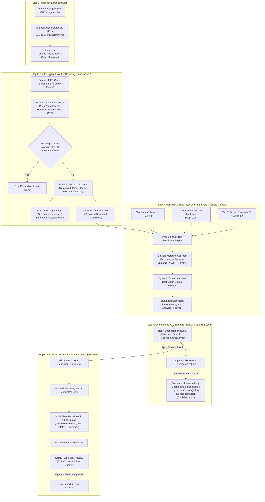

# System Architecture & Scaling Specification Report (`scaling_report.md`)

This report provides the authoritative specification of the automated Oracle Recruiting Cloud workflow, the multi-tier answer resolution architecture, the 5-stage similarity matching cascade, the dashboard operator review model, the file inventory, and the execution roadmap for scaling to production.

---

## 1. Executive Summary & Architecture Verdict

### Verdict: **On the Right Path**
The system architecture matches the operational requirements:
- **Separation of Identities**: Uses a pool of **3 dummy accounts** for exploratory scanning (preserving clean candidate history) and the **actual candidate's email** (`data/clients.json`) for final form filling.
- **Resource Constraints (The Rule of 3)**: Caps local concurrency to **3 active Playwright browsers** with a **mandatory >= 10-second cooldown** between job navigations to prevent rate limits and memory bloat.
- **Multi-Tier Resolution & 5-Stage Similarity Cascade**: Combines client profiles (`data/clients.json`), question bank (`data/question-bank.json`), and resume data across 5 deterministic, fuzzy, semantic, and LLM matching stages with strict confidence thresholds.
- **Full Question Visibility on Dashboard**: All questions—both auto-resolved and unresolved—are rendered on the dashboard. Any operator modification to a resolved or unresolved field updates the application immediately and trains the question bank.
- **Human-in-the-Loop Safety Policy**: Form filling halts strictly before submission (`needs_review`). Submission is executed **only upon explicit human operator review and confirmation**.

---

## 2. End-to-End Workflow Diagram



---

## 3. Detailed Phase Specifications

### Step 1: Ingestion & URL Canonicalization
- **Primary Source**: `data/oracle_jobs.csv` (contains 988 job rows with `company_name,job_url,score,client_name,applywizz_id`).
- **Processing**:
  - Validates CSV rows.
  - Strips tracking tokens (`utm_*`, `source`, `ref`).
  - Canonicalizes paths (supports both `/job/<id>` and `/requisitions/preview/<id>`).
  - Deduplicates jobs across users (988 assignment rows collapse to ~150–200 unique job requisitions).
  - Preserves every `applywizz_id + jobId` assignment link.
- **Output**: `data/jobs.json`.
- **Files Involved**: `src/phases/phase1-ingest-auth.js`, `src/shared/url.js`, `src/shared/csv.js`.

---

### Step 2: Multi-Worker Controlled Scanning (Phases 1 & 2)
- **Concurrency & Identities**:
  - Spawns **3 concurrent Playwright Chromium workers**.
  - Uses **3 distinct dummy scanner accounts** from `.env` (`SCANNER_EMAIL_1..3`).
  - Enforces a **mandatory >= 10-second cooldown** after a job finishes before that worker opens the next queued link.
- **Phase 1 Automated Login & Skip Detection**:
  - Waits up to 25s total for initial page render and Apply button.
  - **Skip Edge Case 1 (`NO_APPLY_BUTTON`)**: If the requisition is closed, expired, or has no Apply button, skips cleanly and logs reason.
  - **Skip Edge Case 2 (`ALREADY_APPLIED`)**: If the job page displays "Applied" upfront or displays "applied to this job" during the 10s post-login settle window, skips cleanly without passing to Phase 2.
  - Handles Phone-to-Email toggle, selects required legal consent checkboxes, bypasses hidden honeypots, and fetches the 6-digit OTP via Zoho Mail API.
- **Phase 2 Schema Extraction & Branch Exploration**:
  - Detects form layout: single-page vs multi-page steps.
  - **Direct Branch Exploration**: Test-clicks single-select radio options and multi-select pill buttons in isolation, captures revealed conditional questions (`visibleWhen: { field, equals/includes }`), and resets baseline.
  - **Repeatable Section Discovery**: Explores `+ Add` buttons (Experience, Education, Supporting Links) and cleanly rolls back temporary rows via Cancel buttons.
  - **Artifact Evidence**: Saves full DOM snapshot (`page.html`) and full-page screenshot (`page.png`) to `data/runtime/scans/<jobId>/`.
  - **Output**: Writes versioned form blueprints to `data/form-templates.json`.
- **Files Involved**: `src/phases/phase2-scan-normalize.js`, `src/adapters/oracle/oracle-recruiting.js`, `src/adapters/mail/zoho-mail-reader.js`.

---

### Step 3: Multi-Tier Answer Resolution & Similarity Matching Stages (Phase 3)

The answer resolution engine maps **`Job ID` — `applywizz_id` — `Question ID` — `Answer Value`** into `data/applications.json`.

#### Part 1: The 3 Data Source Tiers (Priority Order & Confidence Caps)

Incoming questions probe candidate data in a strict 3-tier hierarchy:

| Data Tier | Source | What It Contains | Confidence Cap |
|---|---|---|:---:|
| **Tier 1: Client Profile** | `data/clients.json` | Explicit personal data (`full_name`, `phone_number`, `address`, `email`, `highest_education`, `cumulative_gpa`, `work_auth_status`, `visa_type`, `eeo_*`). | **1.0 (Highest)** |
| **Tier 2: Question Bank** | `data/question-bank.json` | Historical bank of confirmed questions and answers previously approved by operators or candidates across past jobs. | **0.90 – 0.98** |
| **Tier 3: Parsed Resume** | Client's resume link / PDF / parsed text | Extracted employment history, education, skills, graduation dates, degree names, certifications. | **0.80 – 0.90** |

The final assigned confidence score respects the source ceiling:
$$\text{Final Confidence} = \min(\text{Stage Matching Score}, \text{Tier Confidence Cap})$$

---

#### Part 2: The 5-Stage Matching Cascade & Similarity Threshold Levels

Every field is evaluated against the data tiers using the following 5 algorithmic stages and threshold boundaries:

```
    [Form Question]
           │
           ▼
    [Stage 1: Regex & Intent Taxonomy] ──── Score ≥ 0.95 ───► AUTO-RESOLVE (High)
           │ Score < 0.95
           ▼
    [Stage 2: Token-Sort Fuzzy Match] ───── Score ≥ 0.85 ───► AUTO-RESOLVE (Medium-High)
           │ Score < 0.85
           ▼
    [Stage 3: Semantic Synset Overlap] ──── Score ≥ 0.78 ───► AUTO-RESOLVE (Medium)
           │ Score < 0.78
           ▼
    [Stage 4: LLM API Fallback] ─────────── Score ≥ 0.70 ───► AUTO-RESOLVE (Reasoned)
           │ Score < 0.70 / Disabled
           ▼
    [Stage 5: Dashboard Human Review] ──────────────────────► Flag as 'needs_input' (0.0)
```

#### Detailed Stage Breakdown & Cutoff Levels

1. **Stage 1: Deterministic Exact & Canonical Intent Taxonomy**
   - **Method**: Exact string normalization, canonical slug lookup, and Regex Intent Synsets (e.g., `VISA_SPONSORSHIP`, `WORK_AUTHORIZATION`, `SECURITY_CLEARANCE`, `GOVERNMENT_OFFICIAL`, `DISABILITY`, `VETERAN`, contact info).
   - **Confidence Level**: `0.95 – 1.0` (Near Certainty).
   - **Action**: Auto-resolved immediately with zero ambiguity.
   - **Examples**:
     - Form: *"Are you legally authorized to work in the United States?"* $\to$ Matches `WORK_AUTHORIZATION` intent $\to$ Score: `1.0`.
     - Form: *"Phone Number"* $\to$ Matches standard contact field $\to$ Score: `1.0`.

2. **Stage 2: Token-Sort Fuzzy Matching (Levenshtein & Token-Set Ratio)**
   - **Method**: Strips punctuation and stop words, normalizes casing, sorts tokens alphabetically, and calculates string similarity (Levenshtein distance & Jaccard token overlap).
   - **Threshold Levels**:
     - **Score $\ge$ 0.85 (Auto-Accept)**: Accepted as a valid match without human intervention.
     - **0.75 $\le$ Score < 0.85 (Conditional)**: Accepted only if the field's available options (e.g., Yes/No or specific dropdown choices) also confirm a clean match via `findBestOptionMatch`.
     - **Score < 0.75 (Reject)**: Passes to Stage 3.
   - **Example**: Form: *"Do you have lawful authorization to work in the U.S.?"* vs. Bank: *"Are you authorized to work in the US?"* $\to$ Token Sort Ratio: `0.88` $\to$ Auto-Accepted.

3. **Stage 3: Fast Semantic Synsets & Option Choice Reducer**
   - **Method**: Token intersection against weighted domain synonym clusters, combined with dynamic option mapping (`scoreOptionMatch` in `src/domain/coercion.js`) when the target is a dropdown or radio list.
   - **Threshold Levels**:
     - **Score $\ge$ 0.78 (Auto-Accept)**: Question semantic intent is confirmed, and candidate answer matches one of the live form options.
     - **Score < 0.78 (Reject)**: Passes to Stage 4 (LLM).
   - **Example**: Candidate answer: `"Bachelor's Degree"`. Target options: `["High School", "B.S. / B.A.", "Bachelor of Science", "Master of Science"]`. Option Matcher maps `"Bachelor's Degree"` $\to$ `"Bachelor of Science"` with score `80+` $\to$ Auto-Accepted.

4. **Stage 4: LLM API Fallback**
   - **Method**: Structured prompt sent to an LLM API (OpenAI / Claude / Gemini) containing the candidate profile, resume excerpt, question text, and form options.
   - **Threshold Levels**:
     - **Score $\ge$ 0.70 (Auto-Accept)**: Model returns a structured JSON answer with high self-reported confidence.
     - **Score < 0.70 (Reject)**: Ambiguous questions or missing candidate context are rejected.
   - **Usage**: Reserved strictly for company-specific qualitative screening questions (e.g., *"Describe your experience with government procurement procedures under FAR"*).

5. **Stage 5: Dashboard Human Review**
   - **Confidence Level**: `< 0.70` or `null`.
   - **Status**: Staged as `needs_input` in `data/applications.json`.
   - **Action**: Highlighted on the web dashboard for operator review and manual entry. Once saved by an operator, recorded with `confidence: 1.0` (Human Verified) and written back to `data/question-bank.json`.

---

#### Decision Cutoffs Summary Matrix

| Score Range | Classification | Resolution Action | Operator Review Required? |
|---|---|---|:---:|
| **0.95 – 1.00** | Exact / Canonical Match (Stage 1) | Auto-resolved in 1ms | **No** |
| **0.85 – 0.94** | High-Confidence Fuzzy (Stage 2) | Auto-resolved | **No** |
| **0.78 – 0.84** | Semantic Synset Match (Stage 3) | Auto-resolved if option maps cleanly | **No** |
| **0.70 – 0.77** | LLM Reasoning Match (Stage 4) | Auto-resolved via LLM | **Flagged for optional review** |
| **< 0.70** | Unresolved / Ambiguous (Stage 5) | Set to `null`, status `needs_input` | **Yes (Mandatory)** |

---

#### Dynamic Type Coercion & Best-Match Option Selection (`src/domain/coercion.js`)
- **Boolean Safety**: Single checkboxes and boolean values are coerced safely (`"No"`, `"false"`, `0` evaluate to `false`), preventing JavaScript's truthy string bug.
- **Best-Match Option Ranking**: When matching candidate answers against Oracle live dropdown options:
  - Exact match: Score 100
  - Substring containment: Score 80
  - Token overlap: Score 60
- **Comma-delimited Strings**: Parses strings like `"Python, SQL, AWS"` into arrays for multi-select pills and checkboxes.
- **Visibility Equivalence**: In `isFieldVisible`, conditional branches equate boolean `true` with `"Yes"` and `false` with `"No"`.
- **Files Involved**: `src/phases/phase3-answer-resolution.js`, `src/domain/coercion.js`, `src/domain/form-template.js`.

---

### Step 4: Dashboard Review & Continuous Learning

- **Web UI**: React + Vite (`web/src/App.jsx`).
- **Comprehensive Question Visibility Policy**:
  > **Note**: For complete auditability and control, **ALL questions—both resolved (green) and unresolved (amber/red)—are rendered in the dashboard**. Operators can review every single value that was auto-resolved.
- **Bidirectional Editing & Override Support**:
  - If an operator edits **any field** on the dashboard—whether fixing an unresolved field or changing an auto-resolved value—the application updates immediately upon saving.
  - The updated value is assigned `confidence: 1.0` (Human Verified).
- **Continuous Learning Loop**:
  - When the operator clicks **"Save Answers"**:
    1. Updates `data/applications.json` with the new values.
    2. Automatically upserts the verified question-and-answer pair into `data/question-bank.json` under Tier 2.
    3. Future applications encountering this question will automatically resolve using this verified human answer.
- **Filtering**:
  - **Filter by Client (`applywizz_id`)**: Select a specific candidate to see only their assigned applications.
  - **Filter by Job (`jobId`)**: Inspect an individual job requisition.
- **Dynamic Rendering**: Child questions revealed by parent selections appear dynamically based on `visibleWhen`.
- **Files Involved**: `web/src/App.jsx`, `src/server.js`.

---

### Step 5: Resource-Constrained Live Form Filling (Phase 4)
- **Local Concurrency Limit**: Capped at **only 3 active browser fills** at a time.
- **Trigger**: **"Apply when clicked"** (operator initiates the fill from the dashboard or CLI).
- **Candidate Identity**: Authenticates using the **actual candidate's email** from `data/clients.json` (`company_email` or `personal_email`).
- **DOM-Driven Execution**:
  - Multi-pass filler (Pass 1 fills primary questions; Pass 2 fills newly revealed conditional questions).
  - **Live Role Detection**: If a field was scanned as text but Oracle renders `role="combobox"` or `.cx-select-input`, it dynamically routes to combobox search and listbox item selection.
  - **Pill & Custom Checkbox Targeting**: Clicks visible labels and custom button elements (`.apply-flow-input-checkbox__button`, `button[role="radio"]`), bypassing hidden native controls.
  - Uploads the candidate's PDF resume.
  - Advances through steps until the final step containing the *Submit* button is reached.
- **STRICT SAFETY HALT**:
  - **The filler never clicks Submit**.
  - Upon detecting the Submit button, it halts immediately and sets application status to `needs_review`.
- **Submission Gate**:
  - The operator inspects the live browser session, reviews the per-field audit, types the exact Job ID confirmation, and clicks Submit.
- **Files Involved**: `src/phases/phase4-apply-review-submit.js`, `src/adapters/oracle/oracle-recruiting.js`.

---

## 4. Complete Codebase & File Map

| Path | Purpose in Intended Workflow | Current Status |
|---|---|:---:|
| `data/clients.json` | 179 candidate profiles (`client` + `additional_information`) | 🟢 Ready (731 KB) |
| `data/oracle_jobs.csv` | 988 job assignment rows linking companies, URLs, and clients | 🟢 Ready (150 KB) |
| `data/jobs.json` | Deduplicated canonical jobs and assignment state | 🟢 Active |
| `data/form-templates.json` | Scanned dynamic form schemas, branches, and field options | 🟢 Active |
| `data/applications.json` | Unified operational store (`Job - Client - Questions - Answers`) | 🟢 Active |
| `data/question-bank.json` | Self-learning repository of confirmed question-answer pairs | 🟢 Active |
| `data/runtime/scans/<jobId>/` | Disposable scan evidence (HTML DOM + full page screenshot) | 🟢 Active |
| `scripts/fetch_clients.mjs` | Client fetcher, reconciler, and active-list pruning tool | 🟢 Ready |
| `src/domain/coercion.js` | Value coercion & Best-Match Option Selection engine | 🟢 Ready (49 tests) |
| `src/domain/form-template.js` | Form flattening & conditional branch evaluation (`isFieldVisible`) | 🟢 Ready |
| `src/adapters/oracle/oracle-recruiting.js` | Playwright adapter (Auth, Scanning, Branching, DOM-driven Fill) | 🟢 Ready |
| `src/adapters/mail/zoho-mail-reader.js` | Multi-signal Zoho OTP email retriever | 🟢 Ready |
| `src/phases/phase1-ingest-auth.js` | CSV ingestion & serialized OTP authentication | 🟡 Update for `oracle_jobs.csv` |
| `src/phases/phase2-scan-normalize.js` | Form walker & branch normalizer | 🟡 Wrap in 3-worker queue |
| `src/phases/phase3-answer-resolution.js` | Multi-tier answer resolution engine with 5-stage cascade | 🟡 Implement 5-stage cascade & bridge `clients.json` |
| `src/phases/phase4-apply-review-submit.js` | Candidate form fill, per-field audit, and safety review gate | 🟡 Add 3-fill queue |
| `web/src/App.jsx` | React dashboard UI (renders all resolved & unresolved fields, client/job filters) | 🟡 Add full field display & filters |
| `src/cli.js` & `src/server.js` | Terminal CLI and Express REST API | 🟢 Active |
| `test/` | 49 automated unit tests | 🟢 49 passed, 0 failed |

---

## 5. Next Steps Implementation Roadmap

1. **Step 1: CSV Ingestion Update**:
   - Update `Phase1IngestAuth.prototype.ingestCsv` to accept `data/oracle_jobs.csv` headers (`applywizz_id`, `company_name`, `job_url`, `score`), automatically deduplicating the 988 rows into unique job links in `data/jobs.json`.
2. **Step 2: Client Profile Resolution Bridge & 5-Stage Cascade (Phase 3)**:
   - Update `Phase3AnswerResolution` to incorporate:
     - The 3-tier hierarchy (`clients.json` ➔ `question-bank.json` ➔ parsed resume).
     - The 5-stage matching cascade with score cutoffs (Taxonomy $\ge 0.95$, Fuzzy $\ge 0.85$, Semantic Option Reducer $\ge 0.78$, LLM $\ge 0.70$, Dashboard fallback).
     - Confidence capping by source tier.
3. **Step 3: 3-Worker Scanner Queue (`src/phases/scan-queue.js`)**:
   - Implement the FIFO queue orchestrator for Phase 2: cycles 3 dummy scanner emails, opens 3 browsers concurrently, and pauses 10 seconds per worker between jobs.
4. **Step 4: Dashboard Full Question Visibility & Filtering**:
   - Update `web/src/App.jsx` to render **all fields (resolved and unresolved)** for complete operator visibility and override control, alongside dropdown filters for **Client (`applywizz_id`)** and **Job (`jobId`)**.
